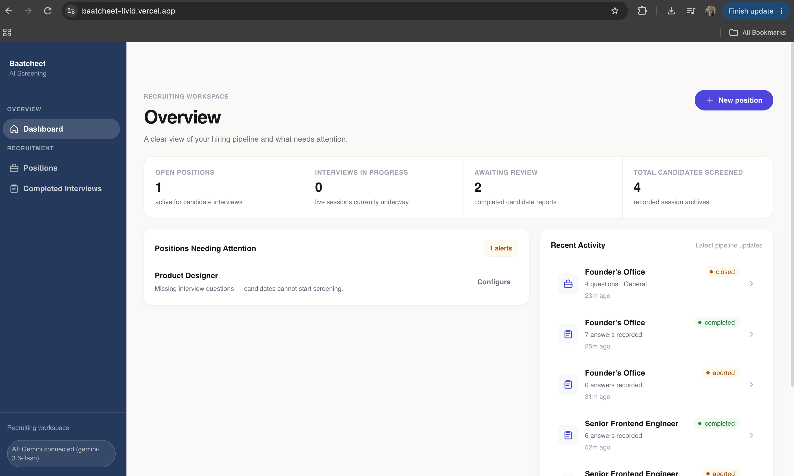
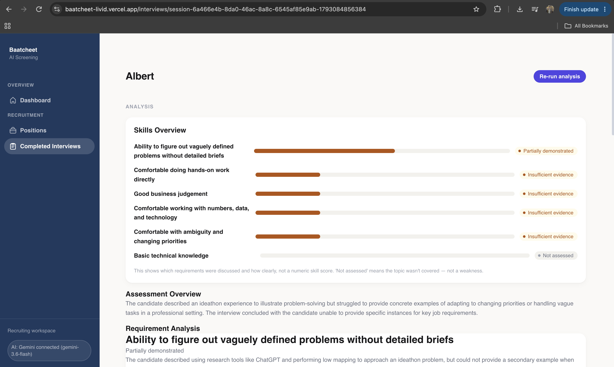
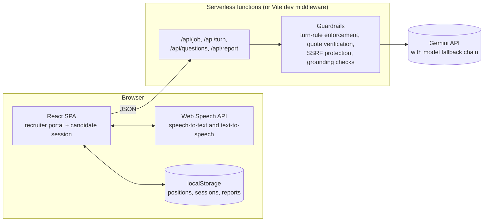
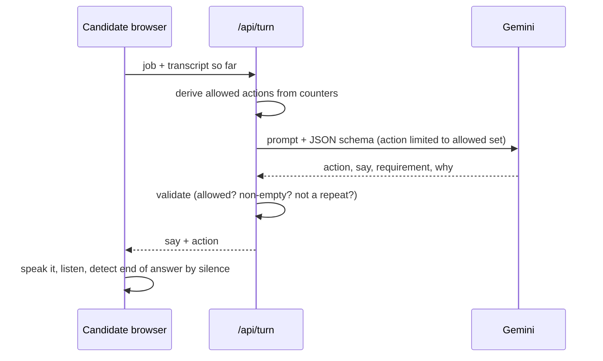

# Baatcheet

**Voice-first screening interviews, with a report where every claim has to point at something the candidate actually said.**

Live demo: [https://baatcheet-livid.vercel.app/]

A recruiter pastes in a job posting. Baatcheet pulls out the requirements, suggests screening questions, and lets a candidate have a short spoken interview with an AI interviewer in the browser. Afterwards the recruiter gets a report that says, per requirement, how well it was demonstrated, backed by verbatim quotes that the server has checked against the transcript.

It does not score people, rank them, or recommend hiring decisions. It organises evidence so a human can decide faster.

| Recruiter dashboard | Generated interview report |
|---|---|
|  |  |

---

## Why I built it this way

Most "AI interviewer" demos are a chat box wrapped around a prompt. The model decides everything: when to stop, what to ask, what to conclude. That is fun to demo and hard to trust.

The idea behind Baatcheet is simple: **the LLM proposes, the server disposes.** Gemini writes the words and makes judgment calls, but the rules of the interview and the integrity of the report are enforced in plain code that doesn't hallucinate.

| Where an LLM could go wrong | What the code does about it |
|---|---|
| Interviewer asks endless follow-ups, or ends after one question | The server computes which actions are legal this turn from counters (max 2 consecutive follow-ups, fixed number of main questions) and only lets the model pick from those. Anything else is rejected. |
| Interviewer repeats itself or returns an empty or enormous reply | Output is validated: action must be in the allowed set, text must be non-empty, under 700 characters, and not a duplicate of an earlier interviewer line. |
| Report cites quotes the candidate never said | Every evidence quote is matched against the candidate's lines (whitespace- and case-normalised). Unverifiable quotes are dropped. |
| Report says "Demonstrated" with nothing to back it up | If a Demonstrated or Partially demonstrated finding loses all its quotes, it's automatically downgraded to Insufficient evidence and flagged. |
| Job import invents requirements that aren't in the posting | Extracted items must share at least 60% of their meaningful words with the source text, or they're discarded (and the discard count is returned). |
| Candidate (or a job posting) tries prompt injection | Untrusted job and candidate text is explicitly separated from system instructions (wrapped in `<candidate_data>` / `<job_text>` tags that the system prompt declares to be data), and model outputs are validated server-side. These safeguards reduce the risk but do not eliminate prompt injection. |
| Model reads personality into how someone talks | The prompt forbids inferring honesty, emotion or confidence from delivery. The report has four categorical statuses, no numeric scores, and no hiring recommendation. |
| "We didn't ask about it" being read as "they can't do it" | `Not assessed` is its own status and the UI says explicitly that it is not a negative finding. |

---

## How it works

### The flow

1. **Create a position.** Import from a LinkedIn job URL, any public job page, a PDF, a `.txt`/`.md` file, or pasted text. Gemini extracts title, company, summary, responsibilities and 3 to 8 requirements (required or preferred). You can edit everything.
2. **Write or generate questions.** Add your own, or ask for 3 to 5 suggestions. Each suggestion must map to exactly one listed requirement, and near-duplicates of existing questions (80% word overlap) are filtered out.
3. **Activate it and run the interview.** The candidate opens `/interview/:jobId`, sees a consent screen, enters their name, and talks. The interviewer speaks via browser text-to-speech; the candidate answers via browser speech recognition. Candidates can repeat, clarify, skip, pause, start an answer over, or end early.
4. **Read the report.** At `/interviews/:id` the transcript is sent for analysis and the report comes back in four sections: Assessment Overview, Requirement Analysis (status, reasoning, verified quotes, what's missing), Full Interview Transcript, and Analysis Status.

### Architecture



The Gemini key only ever exists on the server side. The browser talks to `/api/*` and nothing else.

### One interview turn



The server is stateless: the client sends the transcript each turn. That keeps it trivially deployable as serverless functions, at the cost of a payload that grows (capped at 200 KB).

On the client, the interview runs through an explicit state machine (`IDLE → PRE_CHECK → READY → SPEAKING_QUESTION → LISTENING → PROCESSING_RESPONSE → FOLLOW_UP / next question → COMPLETED`, with `PAUSED`, `ABORTED` and `ERROR` as side states). Voice end-of-answer detection is silence-based (2 s by default).

### Resilience

Gemini model names and quotas change, so the server doesn't depend on one model. It tries `GEMINI_MODEL`, then `GEMINI_FALLBACK_MODEL`, then a built-in chain. A model that returns 429 is skipped for 10 minutes, a 404 for 6 hours, and transient failures (500/503/504, timeouts, malformed output) get one retry before moving on. Errors reach the UI as short codes (`gemini_quota_exhausted`, `gemini_timeout_or_network`, ...) that the frontend maps to readable messages.

Job import fetches arbitrary URLs, so it blocks private, loopback, link-local and cloud-metadata addresses, re-checks on every redirect (max 3), and caps response size.

---

## Getting started

**Prerequisites:** Node 18+ (developed on Node 22) and a [Gemini API key](https://aistudio.google.com/apikey).

```bash
git clone https://github.com/SrishBansal/Baatcheet.git
cd Baatcheet
npm install

cp .env.example .env.local
# open .env.local and set GEMINI_API_KEY

npm run dev
```

Open http://localhost:5173. There is no separate backend process: in development the API runs as a Vite middleware, and in production the same handler runs as Vercel functions.

The sidebar shows `AI: Gemini connected (<model>)` when the key is picked up. If it says `NOT configured`, check `.env.local` and restart the dev server.

**Try it in two minutes:** the app seeds a few synthetic positions on first load. Open one from **Positions**, hit **Test interview** (draft positions) or **Start interview** (active ones), answer a couple of questions (vaguely on one of them, to see a follow-up), finish, and open the result from **Completed Interviews**.

> **Browser note:** voice input needs the Web Speech API, which in practice means Chrome or Edge. In other browsers, enable typed answers on the position and the interview falls back to text.

### Environment variables

All of these are server-side only. Nothing here is prefixed `VITE_`, so nothing is bundled into the client.

| Variable | Required | Purpose |
|---|---|---|
| `GEMINI_API_KEY` | yes | Google AI Studio key. |
| `GEMINI_MODEL` | no | Model to try first. |
| `GEMINI_FALLBACK_MODEL` | no | Comma-separated fallbacks, tried in order. |
| `GEMINI_BASE` | no | Override the Gemini base URL. |
| `GEMINI_RETRY_MS` | no | Delay before retrying a transient failure (default 1500). |
| `PORT` | no | Only used when running the engine standalone. |

---

## API

All routes are `POST` with a JSON body except health. Errors come back as `{ "error": "<code>" }` with a meaningful HTTP status.

| Route | Body | Returns |
|---|---|---|
| `GET /api/health` | none | `{ geminiConfigured, model }` |
| `POST /api/job` | one of `{ url }`, `{ text }`, `{ fileText }`, `{ pdfBase64 }` | `{ source, job: { title, company, summary, responsibilities[], requirements[{name, kind}] }, discarded, sourceChars }` |
| `POST /api/turn` | `{ job, transcript: [{ role, text, action? }] }` | `{ action, say, requirement, why, questionIndex }` where action is `INTRO`, `FOLLOW_UP`, `NEXT_QUESTION` or `WRAP_UP` |
| `POST /api/questions` | `{ job, existing[], count }` | `{ questions: [{ text, requirementName }] }` |
| `POST /api/report` | `{ job, transcript }` | `{ summary, requirements: [{ name, status, reasoning, missing, evidence[], flag }], droppedQuotes, model, generatedAt }` |

Body limits: 200 KB generally, 8 MB for `/api/job` (to allow PDFs).

---

## Deploying to Vercel

1. Push to GitHub and import the repo in Vercel (framework preset: Vite).
2. Add `GEMINI_API_KEY` under Settings → Environment Variables.
3. Deploy. The five files in `api/` are thin wrappers around the same handler used in development; `vercel.json` sends every non-API path to `index.html` so deep links like `/positions/new` survive a refresh.

---

## Testing

```bash
npm test          # run the whole suite once
npm run test:watch
```

The suite covers the pieces where bugs would actually hurt: the interview state machine, voice endpointing, the turn-rule guard, quote verification and downgrade logic, model fallback and cooldowns, SSRF blocking, job-import grounding, session persistence, and page rendering. Gemini is stubbed, so tests never hit the network or cost money.

For a real end-to-end check against a running server and a real key:

```bash
npm run dev
node scripts/smoke.mjs http://localhost:5173
```

The smoke script exercises the live API end to end (intro turn, a vague answer triggering a follow-up, a detailed answer advancing, turn limits forcing a wrap-up, report quotes being verifiable, uncovered requirements coming back as `Not assessed`, text/PDF/URL job import, and SSRF blocking) and exits non-zero if any check fails.

---

## Project structure

```
api/                      Vercel function wrappers (one per route)
server/
  baatcheet-engine.mjs    Gemini client, model chain, job import, turn logic,
                          question suggestions, report + verification, HTTP handler
src/
  pages/                  Dashboard, Positions, JobConfig, InterviewSession,
                          InterviewList, InterviewReport, GeminiReport
  engine/                 Interview state machine, controller, endpointing,
                          question manager, event log
  voice/                  Speech recognition / synthesis adapters, capability detection
  data/                   localStorage store, models, session persistence, API client
  components/             Layout shell and UI primitives
  utils/                  Validation, status visuals, job import helpers
tests/                    Mirrors src/ and server/, plus HTML fixtures for the importer
scripts/smoke.mjs         Live end-to-end check
```

---

## Decisions and trade-offs

| Decision | Why | What it costs |
|---|---|---|
| Server uses only Node built-ins (`http`, `fetch`, `dns`) | Nothing to patch, nothing to configure, near-instant cold starts, and the same handler works under Vite and Vercel. | Routing and body parsing are hand-rolled instead of coming from a framework. |
| Interview rules live in code, not in the prompt | Prompts are suggestions; counters and validators are guarantees. | A bit more code, and the model sometimes gets rejected and has to be retried. |
| Stateless turn endpoint | Works on serverless with no database. | The whole transcript is re-sent every turn. |
| Categorical statuses instead of numeric scores | A "7.3 / 10" from an LLM is fake precision. Four honest categories are easier to defend and harder to misuse. | Less satisfying to sort by. |
| Browser Web Speech API for voice | Free, zero setup, low latency. | Chrome/Edge only, and in Chrome the audio is processed by Google's speech service. Candidates are told this at consent. |
| `localStorage` for persistence | No database to host while the product shape was still changing. Accessed through an adapter so it can be swapped out. | See limitations below. |

---

## Known limitations

I'd rather list these than have you find them.

- **Data lives in the recruiter's browser.** Positions, sessions and reports are in `localStorage`. A candidate link only works in the same browser profile that created the position, so this is a single-recruiter prototype, not a multi-user product. Hosted candidate links need a database and auth.
- **No authentication or rate limiting on `/api/*`.** On a public deployment, anyone who finds the URL can spend your Gemini quota. Before real use: auth for the recruiter routes and per-IP rate limiting.
- **A page reload mid-interview aborts that session.** There is no resume yet.
- **Verification proves a quote exists, not that the conclusion is right.** Status and reasoning are still LLM judgments. That is why the report is evidence for a human reviewer, not a verdict.
- **Speech-to-text errors flow into the transcript.** The report says so, and it does not verify the speaker's identity.
- **LinkedIn import uses the unauthenticated guest endpoint.** It can break or be blocked at any time; pasted text and file upload are the reliable paths.
- **Model cooldowns are in memory,** so on serverless they reset on cold starts. Correct, just less efficient.
- **The SSRF guard checks DNS before fetching,** so a DNS rebinding race is theoretically possible. Documented in the code.

## What I'd do next

1. Persist to a real database (Postgres or SQLite) and add recruiter auth.
2. Hosted, expiring candidate links.
3. Rate limiting and a per-request time budget across the model fallback chain.
4. Resume an interrupted interview from the saved transcript.
5. Split `baatcheet-engine.mjs` into modules (client, import, turn, report) and break up the larger React components.
6. CI that runs `npm test` and `npm run build` on every push.
